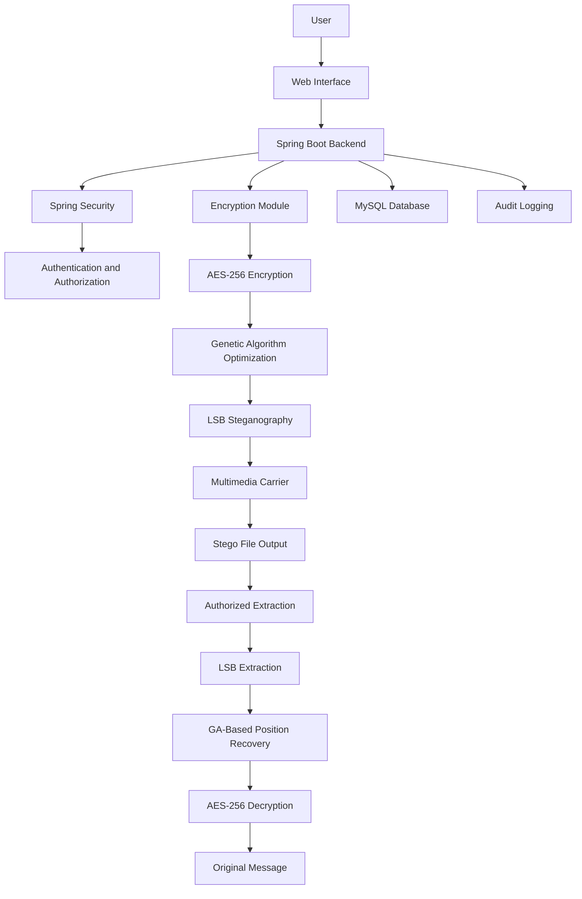
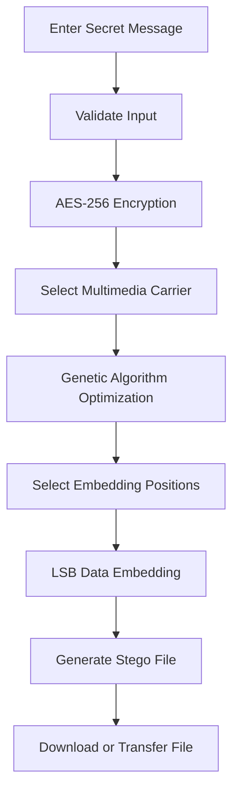
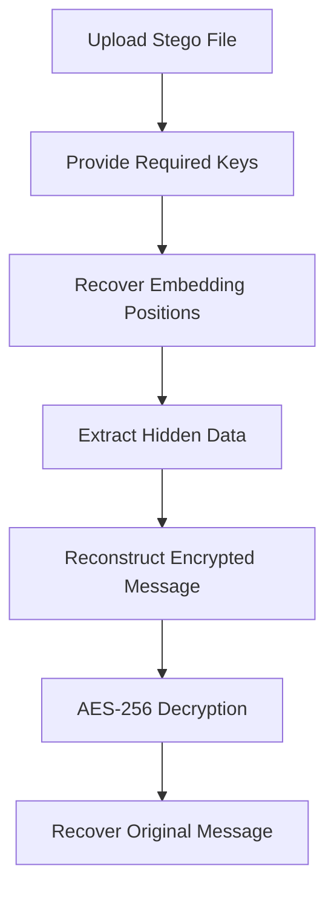

# 🔐 StegnoVault — Secure Steganography System

A secure, web-based data transmission system that combines **AES-256 encryption, Genetic Algorithm (GA) optimization, and Least Significant Bit (LSB) steganography** to protect confidential information by hiding encrypted data inside multimedia files.

Built with **Java, Spring Boot, Spring Security, MySQL, HTML, CSS, and JavaScript**, StegnoVault provides a web application for secure data encoding, decoding, user authentication, and protected information exchange.

---

## 📑 Table of Contents

- [Overview](#-overview)
- [Key Features](#-key-features)
- [Technology Stack](#-technology-stack)
- [System Architecture](#-system-architecture)
- [Encryption and Steganography Workflow](#-encryption-and-steganography-workflow)
- [Security Architecture](#-security-architecture)
- [Supported Media Formats](#-supported-media-formats)
- [Performance and Evaluation](#-performance-and-evaluation)
- [Installation](#-installation)
- [Environment Configuration](#-environment-configuration)
- [Database Configuration](#-database-configuration)
- [Usage](#-usage)
- [Project Structure](#-project-structure)
- [Deployment](#-deployment)
- [Security Considerations](#-security-considerations)
- [Future Improvements](#-future-improvements)
- [Contributing](#-contributing)
- [License](#-license)
- [Author](#-author)

---

## 🌟 Overview

**StegnoVault** is a web-based secure communication application designed to protect sensitive information using multiple layers of security.

Traditional data encryption protects the contents of a message but does not necessarily conceal the existence of the communication. Steganography addresses this limitation by embedding information inside an ordinary multimedia file.

StegnoVault combines three complementary techniques:

1. **AES-256 Encryption:** Encrypts the original message before embedding it.
2. **Genetic Algorithm Optimization:** Selects suitable embedding positions using a fitness-based optimization approach.
3. **LSB Steganography:** Hides encrypted information within the least significant bits of multimedia data.

The application also incorporates authentication and authorization features to protect access to its functionality.

### 🎯 Project Objectives

- Protect confidential information using strong encryption.
- Conceal the existence of messages within multimedia files.
- Optimize embedding positions to reduce perceptual distortion.
- Support secure encoding and decoding workflows.
- Provide authenticated access and role-based authorization.
- Maintain an organized web interface for secure data transmission.

---

## ✨ Key Features

### 🔒 1. AES-256 Encryption

- Encrypts secret messages before embedding.
- Uses AES-256-based cryptographic processing.
- Supports recovery of the original message through the corresponding decryption process.
- Keeps encryption and data-hiding operations as separate security layers.

### 🧬 2. Genetic Algorithm Optimization

- Uses evolutionary optimization to select embedding positions.
- Evaluates candidate positions using image characteristics such as local variance and entropy.
- Aims to minimize visible distortion while embedding encrypted data.
- Uses a GA seed during decoding to reproduce the required embedding-position sequence.

### 🖼️ 3. LSB Steganography

- Embeds encrypted data within multimedia carriers.
- Modifies selected least significant bits to represent the hidden information.
- Enables extraction of embedded information using the corresponding decoding procedure.
- Works with supported carrier formats implemented by the application.

### 🎵 4. Multimedia Support

- **Images:** PNG and JPEG
- **Audio:** WAV
- **Video:** MP4

Supported formats and processing behavior depend on the corresponding media-handling implementation.

### 👤 5. User Authentication

- User authentication through Spring Security.
- Password hashing using BCrypt.
- Email-based OTP verification.
- Access control for protected application functionality.

### 🛡️ 6. Role-Based Access Control

- Supports role-based authorization.
- Restricts protected operations according to assigned permissions.
- Helps separate user-level functionality from administrative functionality.

### 📋 7. Audit Trail

- Supports audit logging for relevant application activities.
- Helps maintain visibility into security-related operations.
- Provides a foundation for monitoring application usage.

### 🌐 8. Web-Based Interface

- Browser-based interaction with the application.
- HTML, CSS, and JavaScript frontend.
- Spring Boot backend for application processing.
- MySQL database integration for persistent data.

---

## 🛠️ Technology Stack

| Technology | Purpose |
|---|---|
| Java | Core application programming language |
| Spring Boot | Backend application framework |
| Spring Security | Authentication and authorization |
| Maven | Dependency management and build automation |
| MySQL | Relational database |
| HTML5 | Frontend structure |
| CSS3 | Frontend styling |
| JavaScript | Client-side interaction |
| AES-256 | Confidentiality through encryption |
| Genetic Algorithm | Optimization of embedding positions |
| LSB Steganography | Hiding encrypted data in multimedia carriers |
| BCrypt | Password hashing |
| Email OTP | Additional account verification |

---

## 🏗️ System Architecture

StegnoVault follows a layered architecture in which the frontend communicates with the Spring Boot backend, and the backend coordinates authentication, cryptographic processing, steganography, and database operations.



### Architecture Components

- **Presentation Layer:** Provides the user-facing web interface.
- **Application Layer:** Coordinates requests and application services.
- **Security Layer:** Handles authentication and authorization.
- **Cryptographic Layer:** Encrypts and decrypts secret information.
- **Optimization Layer:** Determines suitable embedding positions.
- **Steganography Layer:** Embeds and extracts encrypted information.
- **Persistence Layer:** Stores application data in MySQL.
- **Audit Layer:** Records relevant security and application activities.

---

## 🔄 Encryption and Steganography Workflow

### Encoding Process



1. The user supplies the secret message.
2. The application validates the required inputs.
3. The message is encrypted using AES-256.
4. The user selects a supported multimedia carrier.
5. The Genetic Algorithm evaluates candidate embedding positions.
6. The LSB process embeds the encrypted data.
7. The application produces a stego file containing the hidden information.

### Decoding Process



1. The user supplies the stego file and the required decoding information.
2. The application reconstructs the embedding-position sequence using the appropriate GA seed.
3. The hidden encrypted data is extracted.
4. The extracted ciphertext is reconstructed.
5. The AES-256 decryption process recovers the original message when the required cryptographic parameters are correct.

**Important:** Successful recovery depends on using compatible encoding and decoding parameters, keys, seeds, and carrier-processing procedures.

---

## 🔐 Security Architecture

StegnoVault uses multiple security mechanisms to address different aspects of information protection.

| Security mechanism | Purpose |
|---|---|
| AES-256 encryption | Protects message confidentiality |
| LSB steganography | Conceals the presence of embedded data |
| GA-based position optimization | Optimizes embedding-position selection |
| BCrypt password hashing | Protects stored password representations |
| Email OTP verification | Adds an account-verification step |
| Spring Security | Enforces application security rules |
| Role-based authorization | Restricts access to protected operations |
| Audit trail | Records relevant application activities |

Encryption and steganography serve different purposes: encryption protects the message content, while steganography attempts to conceal the presence of the message.

---

## 🗂️ Supported Media Formats

| Media type | Format | Application purpose |
|---|---|---|
| Image | PNG | Hidden-data carrier |
| Image | JPEG | Hidden-data carrier |
| Audio | WAV | Hidden-data carrier |
| Video | MP4 | Hidden-data carrier |

The supported carrier formats do not necessarily imply identical capacity, performance, or robustness across formats.

---

## 📊 Performance and Evaluation

The project has reported the following experimental results for its optimized embedding approach:

| Metric | Reported result |
|---|---:|
| Average PSNR | 51.8 dB |
| Improvement over sequential LSB | 4.5 dB |
| Reported MSE | Below 0.005 |
| Reported SSIM | Above 0.9997 |
| Reported payload capacity | 6,339 characters |
| Reported recovery rate | 100% |

These values are project-reported results, not universal guarantees. Reproduction requires the same evaluation dataset, carrier files, payload conditions, and testing methodology.

### Evaluation Metrics

- **PSNR (Peak Signal-to-Noise Ratio):** Measures the relationship between signal strength and embedding distortion.
- **MSE (Mean Squared Error):** Measures average squared differences between original and processed media samples.
- **SSIM (Structural Similarity Index):** Estimates structural similarity between the original and processed media.
- **Payload Capacity:** Measures the amount of information that can be embedded under defined conditions.
- **Recovery Rate:** Measures successful message recovery across tested cases.

---

## 💻 Installation

### Prerequisites

Install the following software before running the project:

- Java Development Kit (JDK), compatible with the project's configured Java version.
- Maven, or the Maven Wrapper included with the repository.
- MySQL Server.
- Git.
- An IDE such as IntelliJ IDEA, Eclipse, or Visual Studio Code.

### Step 1: Clone the Repository

```bash
git clone https://github.com/TheZohaibKhan/stegnographyBackendbyNewV004.git
```

Navigate into the cloned project directory:

```bash
cd stegnographyBackendbyNewV004
```

### Step 2: Verify Java and Maven

```bash
java -version
```

If Maven is installed separately:

```bash
mvn -version
```

On Windows, you can use the Maven Wrapper if the repository contains `mvnw.cmd`:

```powershell
.\mvnw.cmd -version
```

### Step 3: Configure the Database

Create a MySQL database for the application using the database name and schema expected by the project's configuration.

For example, if your configuration uses `stegnovault`, you can create it with:

```sql
CREATE DATABASE stegnovault;
```

If the application specifies a different database name, use that name instead.

### Step 4: Configure Application Properties

Locate the Spring Boot configuration file, usually:

```text
src/main/resources/application.properties
```

or:

```text
src/main/resources/application.yml
```

Configure the database connection and other required application settings before starting the backend.

See [Environment Configuration](#-environment-configuration) below.

### Step 5: Build the Application

Using Maven:

```bash
mvn clean package
```

On Windows, using the Maven Wrapper:

```powershell
.\mvnw.cmd clean package
```

### Step 6: Run the Application

Using Maven:

```bash
mvn spring-boot:run
```

On Windows:

```powershell
.\mvnw.cmd spring-boot:run
```

Alternatively, execute the packaged JAR produced by the build:

```bash
java -jar target/<application-jar-name>.jar
```

Replace `<application-jar-name>.jar` with the actual JAR filename.

When the application starts successfully, open the configured local address in your browser. A common Spring Boot default is:

```text
http://localhost:8080
```

The actual address depends on the application's configuration and frontend routing.

---

## ⚙️ Environment Configuration

For local development, configure sensitive settings outside source control whenever possible.

Typical configuration categories include:

| Configuration | Description |
|---|---|
| Database URL | JDBC connection URL for MySQL |
| Database username | MySQL account used by the application |
| Database password | Password for that database account |
| Encryption configuration | Parameters required by the cryptographic implementation |
| Email configuration | SMTP settings for OTP verification |
| Application port | Port used by the Spring Boot server |

For example, a Spring Boot configuration may use environment-variable placeholders:

```properties
spring.datasource.url=${DB_URL}
spring.datasource.username=${DB_USERNAME}
spring.datasource.password=${DB_PASSWORD}

server.port=${PORT:8080}
```

These are example settings, not a replacement for the configuration already defined in your project. Match the actual property names and requirements in the source code.

**Never commit database passwords, SMTP credentials, encryption keys, OTP secrets, or production environment files to GitHub.**

---

## 🗄️ Database Configuration

StegnoVault uses MySQL for relational data persistence.

Before starting the application:

1. Install and start MySQL Server.
2. Create the database required by the project.
3. Configure the JDBC URL, username, and password.
4. Verify that the database is reachable.
5. Confirm that the application's configured schema initialization or migration process is available.
6. Start the Spring Boot application and inspect the logs for database connection errors.

The actual tables, relationships, and persistence behavior are determined by the entities, repositories, and database configuration implemented in the repository.

---

## 🚀 Usage

The general application workflow is as follows. The exact screen names and navigation depend on the frontend implementation.

### 1. Access the Application

Open the running web application and navigate to the available authentication or home page.

### 2. Authenticate

Register or sign in using the application's supported authentication flow. Complete email OTP verification when required.

### 3. Prepare the Secret Message

Enter the information to be transmitted through the steganography process.

### 4. Select a Carrier File

Choose a supported image, audio, or video carrier.

### 5. Encode the Message

Run the encoding workflow to encrypt the message, optimize embedding positions, and generate the stego file.

### 6. Transfer the Stego File

Transfer the resulting file to the intended recipient using an appropriate communication channel.

### 7. Decode the Message

The recipient supplies the stego file and the required decoding information to extract and decrypt the hidden message.

### 8. Verify the Result

Confirm that the recovered message matches the original message and that the selected carrier remains usable.

---

## 📁 Project Structure

The following is a conceptual overview of the application's components. The exact package and file names should be taken from the repository.

```text
stegnographyBackendbyNewV004/
│
├── src/
│   └── main/
│       ├── java/
│       │   └── .../
│       │       ├── controller/
│       │       ├── service/
│       │       ├── repository/
│       │       ├── entity/
│       │       ├── security/
│       │       └── ...
│       │
│       └── resources/
│           ├── application.properties
│           ├── static/
│           └── templates/
│
├── pom.xml
├── mvnw
├── mvnw.cmd
├── .gitignore
└── README.md
```

The directory names above illustrate a common Spring Boot organization and may differ from the actual repository.

---

## 🌍 Deployment

StegnoVault is a backend-dependent web application. Its Spring Boot server and MySQL database must be deployed separately from any static frontend hosting.

### Deployment Options

- **Railway:** Can host a Spring Boot application and a provisioned MySQL database, subject to current platform support and plan limits.
- **Render:** Can host a Java web service; database hosting and connectivity must be configured separately.
- **Virtual Private Server (VPS):** Provides control over Java, the application server, database connectivity, and deployment configuration.

### Deployment Checklist

1. Configure the production database and credentials.
2. Set the required environment variables.
3. Build and deploy the Spring Boot application.
4. Configure the frontend to use the deployed backend address where necessary.
5. Enable HTTPS.
6. Restrict database access and protect secrets.
7. Verify authentication, encoding, decoding, and media handling in the deployed environment.

**Note:** GitHub Pages can host a static HTML/CSS/JavaScript frontend, but it cannot run a Spring Boot backend or host its MySQL database. Publishing the repository on GitHub does not automatically deploy the complete application.

---

## 🛡️ Security Considerations

- Use strong, securely generated cryptographic keys.
- Never store plaintext passwords; use an appropriate password-hashing mechanism.
- Protect authentication endpoints and validate authorization on the server.
- Keep database and email credentials outside the public repository.
- Validate uploaded files and enforce reasonable file-size limits.
- Apply safe file handling and output-storage practices.
- Use HTTPS in production.
- Avoid exposing cryptographic keys, sensitive messages, or OTP values in application logs.
- Test the application against malformed files, invalid keys, incorrect seeds, and unauthorized access attempts.

The use of AES-256 and steganography does not automatically guarantee security against every attack. Security depends on the implementation, key management, media-processing behavior, and threat model.

---

## 🔮 Future Improvements

Potential extensions for the project include:

- Advanced steganalysis resistance testing.
- Expanded support for additional media formats.
- Improved embedding-capacity optimization.
- Automated quality and robustness evaluation.
- Enhanced audit dashboards and administrative reporting.
- Comprehensive unit, integration, and security testing.
- Containerized deployment with Docker.
- CI/CD automation for builds and deployments.
- Better monitoring and error reporting.
- More detailed performance comparisons across carrier types.

---

## 🤝 Contributing

Contributions that improve the application's security, reliability, usability, or documentation are welcome.

1. Fork the repository.
2. Create a feature branch.
3. Implement and test your changes.
4. Commit your changes with a descriptive message.
5. Push the branch to your fork.
6. Open a pull request describing the changes.

Please avoid committing secrets, personal data, generated credentials, or confidential test files.

---

## 📄 License

A license has not been specified in this README. Add the appropriate license file and update this section before distributing the project under an open-source license.

---

## 👨‍💻 Author

**Zohaib Khan**

GitHub: [TheZohaibKhan](https://github.com/TheZohaibKhan)

Project Repository: [StegnoVault Backend](https://github.com/TheZohaibKhan/stegnographyBackendbyNewV004)

---

## ⭐ Support the Project

If you find this project useful for learning about secure communication, cryptography, genetic algorithms, or steganography, consider giving the repository a star on GitHub.

**StegnoVault — Encrypt the message. Hide the data. Protect the communication.**
